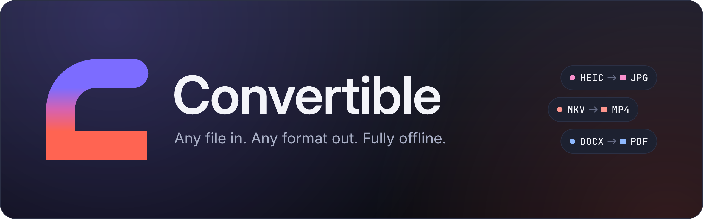
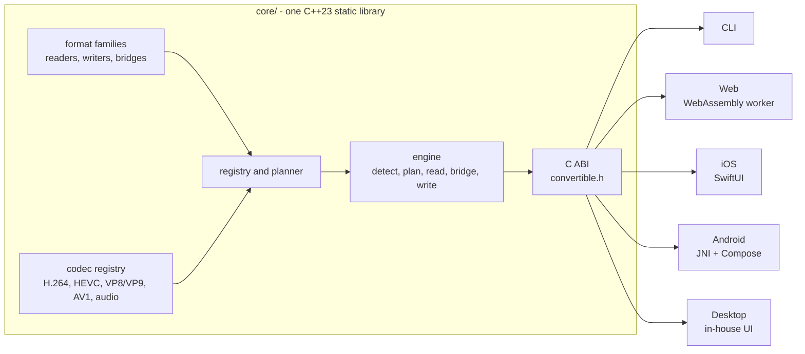

<p align="center">
  <picture>
    <source media="(prefers-color-scheme: dark)" srcset="assets/brand/readme-banner.png">
    <source media="(prefers-color-scheme: light)" srcset="assets/brand/logo-wordmark-light.svg">
    
  </picture>
</p>

<p align="center">
  <a href="https://github.com/J7779/convertible/actions/workflows/ci.yml"></a>
  <a href="https://github.com/J7779/convertible/actions/workflows/release.yml"></a>
</p>

**Convertible** is a universal file converter that never sends your files anywhere. It
recognises hundreds of formats - images, audio, video, documents, spreadsheets, data,
archives, fonts, subtitles, 3D models, maps and more - and converts between a large and
growing share of them entirely on your own device. One C++ engine, written in-house, powers
a command-line tool and native apps for the web, iPhone and iPad, Android, Windows, Linux
and macOS. Drop a file in, pick what you want out, and it is converted (or compressed)
without ever leaving your computer or phone.

> **The privacy promise.** Convertible works offline. It has no servers, no accounts, no
> analytics, no telemetry and no network code: your files are read and written on your
> device and nowhere else. Output is stripped of identifying metadata by default. See
> [docs/PRIVACY.md](docs/PRIVACY.md).

## Platforms

| Platform | App | Source | Build status |
| --- | --- | --- | --- |
| Command line (Linux, macOS, Windows) | `convertible` | [`core/cli`](core/cli) | [](https://github.com/J7779/convertible/actions/workflows/ci.yml) |
| Web (any modern browser, installable PWA) | WebAssembly + hand-written UI | [`apps/web`](apps/web) | [](https://github.com/J7779/convertible/actions/workflows/ci.yml) |
| Android 8.0+ | Kotlin + Jetpack Compose | [`apps/android`](apps/android) | [](https://github.com/J7779/convertible/actions/workflows/ci.yml) |
| Windows 10+, Linux (X11/XWayland), macOS 13.3+ | C++ with an in-house UI toolkit | [`apps/desktop`](apps/desktop) | [](https://github.com/J7779/convertible/actions/workflows/ci.yml) |
| iPhone and iPad (iOS 16.4+) | SwiftUI | [`apps/ios`](apps/ios) | built and tested locally (no CI job: signing needs the owner's certificate) |

Release builds (CLI, desktop, Android APKs, web bundle, checksums) are attached to each
[GitHub Release](https://github.com/J7779/convertible/releases).

## Features

- **Convert** any supported file to any format the engine can reach. The planner finds the
  best route itself (a spreadsheet to an HTML table, a video to an animated GIF or to MP3
  audio), so every new format becomes reachable from everything that already exists.
- **Compress**: re-encode a file into its own format at a lower quality or size
  (PNG to smaller PNG, MP4 to smaller MP4, ZIP to tighter ZIP).
- **Quality presets** (`high`, `balanced`, `small`) and one `quality` scale that means the same
  for every lossy format, plus per-format options (resize, sample rate, bit rate, encoding,
  sheet, ...) rendered from the engine's own option schemas.
- **Formats browser**: every app lists what it can read and write, with search, straight
  from the engine's catalogue.
- **Batch queue** with progress, cancellation and parallel conversions; files in, files out.
- **Hostile-input safe**: every reader is bounds-checked, limit-checked and fuzzed.

## Supported formats

Counts come from the real catalogue (`convertible formats --json`); the full list with
extensions and read/write support is in **[docs/FORMATS.md](docs/FORMATS.md)**. Any file,
even one that cannot be decoded, can also be turned into Base64, hexadecimal, checksums and
the other encodings.

<!-- formats:begin -->
<!-- Generated by tools/gen-formats-doc; do not edit between the markers. -->

| Category | Known | Read | Write | Most common it converts |
| --- | ---: | ---: | ---: | --- |
| Images | 50 | 46 | 45 | jpg, png, gif, tiff, bmp, psd, ico, qr |
| Vector graphics | 2 | 0 | 0 | detected only, for now |
| Audio | 24 | 21 | 21 | mp3, wav, flac, m4a, ogg, aac, opus, alac |
| Video | 20 | 20 | 16 | mp4, mkv, mov, webm, avi, mpg, wmv, m4v |
| Documents | 40 | 33 | 24 | pdf, html, txt, md, eml, ipynb, mediawiki, tex |
| E-books | 3 | 1 | 1 | fb2 |
| Spreadsheets and tables | 23 | 23 | 18 | csv, xlsx, tsv, xls, ods, csv-semicolon, xlsm, dbf |
| Presentations | 3 | 0 | 0 | detected only, for now |
| Data and configuration | 108 | 108 | 87 | json, yaml, xml, toml, sqlite, ini, m3u, m3u8 |
| Archives and compression | 15 | 0 | 0 | detected only, for now |
| Fonts | 4 | 0 | 0 | detected only, for now |
| Subtitles | 21 | 21 | 20 | srt, vtt, ass, lrc, ttml, ssa, dfxp, microdvd |
| 3D models | 30 | 29 | 19 | obj, stl, glb, gltf, 3mf, fbx, ply, dae |
| Geospatial | 30 | 30 | 25 | geojson, gpx, kml, shp.zip, kmz, fit, geocsv, tcx |
| Calendars and contacts | 11 | 11 | 10 | ics, vcf, google-contacts-csv, google-calendar-csv, ldif, outlook-contacts-csv, outlook-calendar-csv, vcs |
| Source code | 121 | 105 | 33 | js, py, css, ts, c, cpp, java, cs |
| Encodings and checksums | 106 | 67 | 105 | base64, hex, checksums, sha256, data-uri, hexdump, md5, base64url |
| Other | 4 | 0 | 0 | detected only, for now |
| **Total** | **615** | **515** | **424** | |

<!-- formats:end -->

## Quick start

### Command line

```sh
cmake --preset release && cmake --build --preset release -j
build/release/core/convertible formats --category image
build/release/core/convertible detect picture.png
build/release/core/convertible targets picture.png
build/release/core/convertible convert picture.png -t jpg --opt quality=80
build/release/core/convertible convert picture.png -t png --opt preset=small -o smaller.png
build/release/core/convertible convert sound.wav -t flac
build/release/core/convertible convert sheet.fods -t csv -o -
build/release/core/convertible convert picture.png -t jpg --list-options
```

Exit status 0 means success; the other codes are listed by `convertible --help`.

### Web

```sh
apps/web/build.sh --docker        # WebAssembly build in the pinned Emscripten container
node apps/web/tools/serve.mjs     # http://127.0.0.1:8080/
```

### Desktop (Windows, Linux, macOS)

```sh
cmake -S . -B build/desktop -DCVT_BUILD_DESKTOP=ON -DCMAKE_BUILD_TYPE=Release
cmake --build build/desktop -j 6 --config Release
```

The app is `build/desktop/apps/desktop/Convertible.app` (macOS),
`build/desktop/apps/desktop/Release/Convertible.exe` (Windows) or
`build/desktop/apps/desktop/convertible-desktop` (Linux).

### Android

```sh
cd apps/android
./gradlew assembleDebug           # needs JDK 17+ and ANDROID_HOME; see apps/android/README.md
./gradlew installDebug            # with a device or emulator attached
```

### iPhone and iPad

```sh
xcodebuild build -project apps/ios/Convertible.xcodeproj -scheme Convertible \
  -destination 'platform=iOS Simulator,name=iPhone 18 Pro' CODE_SIGNING_ALLOWED=NO
```

Or open `apps/ios/Convertible.xcodeproj` in Xcode and press Run.

## How it fits together



Formats are read into a small set of intermediate representations (image, audio, video
stream, document, table, data, archive, ...) and written from them; the planner chains a
reader, up to two bridges and a writer by cost. Every app talks to the same C interface and
discovers formats, targets and options at run time, so a new format family appears in all of
them without app changes. Details: [docs/ARCHITECTURE.md](docs/ARCHITECTURE.md).

```
core/        engine, intermediate representations, format families, codecs, C ABI, CLI, tests
apps/web     WebAssembly build and offline PWA        apps/ios      SwiftUI app
apps/android Kotlin/Compose app with a JNI bridge     apps/desktop  Windows/Linux/macOS app
assets/      brand: logo, icons, design tokens, motion, fonts
docs/        architecture, building, testing, privacy, the generated format list
tools/       documentation, notices and privacy tooling; CI helper scripts
```

## Building from source

Everything builds offline from a clean checkout with each platform's own toolchain; nothing
is downloaded except the Android build's Gradle dependencies. The core needs CMake 3.22+ and
a C++23 compiler (GCC 14, Clang 18 with libc++, Apple Clang 21, MSVC 2022 17.10, Emscripten).

| Component | Command | Guide |
| --- | --- | --- |
| Core, CLI, tests | `cmake --preset dev && cmake --build --preset dev -j && ctest --preset dev` | [docs/BUILDING.md](docs/BUILDING.md) |
| Web | `apps/web/build.sh --docker` | [apps/web/README.md](apps/web/README.md) |
| Desktop | `cmake -S . -B build/desktop -DCVT_BUILD_DESKTOP=ON -DCMAKE_BUILD_TYPE=Release` | [apps/desktop/README.md](apps/desktop/README.md) |
| Android | `cd apps/android && ./gradlew assembleDebug assembleRelease` | [apps/android/README.md](apps/android/README.md) |
| iOS | `xcodebuild build -project apps/ios/Convertible.xcodeproj -scheme Convertible ...` | [apps/ios/README.md](apps/ios/README.md) |

## Testing

```sh
ctest --preset dev                                   # core unit tests + CLI smoke test
cmake --preset asan && cmake --build --preset asan -j && ctest --preset asan   # ASan + UBSan
ctest --test-dir build/desktop -L desktop -C Release --output-on-failure      # desktop
apps/web/test.sh                                     # web (Node, no packages)
cd apps/android && ./gradlew testDebugUnitTest lint  # Android JVM tests and lint
tools/ci/docker-linux.sh gcc                         # Linux CI job in a container
```

Every format is tested against real files written by independent software, with round-trip
quality thresholds and hostile-input fuzzing. See [docs/TESTING.md](docs/TESTING.md).

## Limitations

Convertible is honest about what it cannot do:

- **Not every known format can be decoded yet.** The catalogue also lists formats that are
  only *detected*; the Read and Write columns of [docs/FORMATS.md](docs/FORMATS.md) are the
  truth for the current build.
- **No DRM or decryption**: Convertible does not remove copy protection or open
  password-protected content.
- **Closed formats**: formats without a public specification are supported only as far as
  they can be implemented faithfully from public documentation, and some not at all.
- **Memory**: conversions run in memory (input is memory-mapped, output is assembled in
  memory, default ceiling 2 GiB). The web app runs in a 32-bit WebAssembly heap and refuses
  inputs above 1 GB.
- **Speed**: video codecs are portable C/C++ without SIMD assembly, so encoding video is
  much slower than with hand-tuned native encoders. The web app uses no threads.
- **Platform limits**: the iOS app is not distributed as a binary (signing); macOS and
  Windows release builds are unsigned; the desktop app's screen-reader bridge exists only on
  macOS so far; Android may stop a conversion left running in the background.

## Patents

Some media formats, notably **H.264/AVC, H.265/HEVC and AAC**, are covered by patents in
some countries. Convertible's source code is provided under the MIT licence, which grants no
patent rights. If you distribute binaries that include these codecs, or use them
commercially, you are responsible for obtaining any licences required where you do so.
The VP8, VP9 and AV1 components carry their projects' own patent grants (see
[NOTICES.md](NOTICES.md)).

## Licence

Convertible is released under the [MIT licence](LICENSE). It contains a few components
written elsewhere (video codecs, fonts, Android support libraries) under permissive
licences; their notices are collected in [NOTICES.md](NOTICES.md), generated by
`tools/gen-notices`.

## Contributing

Contributions are welcome: start with [CONTRIBUTING.md](CONTRIBUTING.md), then
[AGENTS.md](AGENTS.md) for the project map, rules and exact commands. Security issues:
[SECURITY.md](SECURITY.md).
