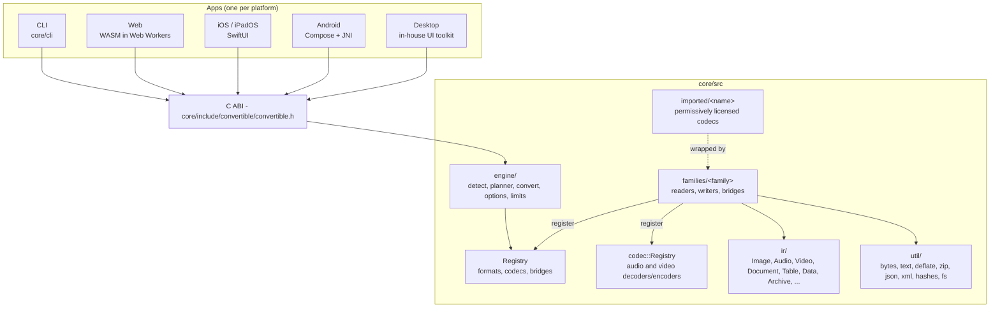

# Architecture

Convertible is one engine and several thin shells. The engine (`core/`) knows every format,
plans every conversion and does all the work; the apps only move bytes in and out, show
progress and render option forms that the engine describes. This page is the overview; the
authoritative details live next to the code in [`core/README.md`](../core/README.md) and in
each `apps/*/README.md`.

## The engine

A conversion is always the same pipeline (`core/src/engine/convert.hpp`):

1. **Resolve and detect** the source format (`engine/detect.hpp`): magic numbers, `sniff`
   functions and extensions are scored and the best match wins. A caller may name the source
   format instead.
2. **Plan** (`engine/planner.hpp`): find the cheapest route
   `reader -> 0..2 bridges -> writer` by summed cost, with deterministic tie-breaks.
3. **Validate options** against every step's `OptionSpec`s: values are coerced, clamped and
   defaulted; unknown keys produce warnings.
4. **Read** the input into an intermediate representation, **bridge** it to another kind if
   needed, **write** the target format, and check the output against the limits.

Errors never cross an interface as exceptions: fallible functions return `Result<T>`
(`std::expected`) and statuses map one to one onto the C ABI and the CLI exit codes. Every
step reports progress through a checkpoint that also implements cancellation. Safety limits
(pixels, decompressed bytes, archive entries, output size) are consulted before anything sized
by the input is allocated.

## Kinds and intermediate representations

Codecs never convert format to format. A reader produces one value of an IR kind and a writer
consumes one (`core/src/ir/`):

| Kind | Holds |
| --- | --- |
| `Blob` | opaque bytes and a file name (every format is implicitly readable as `Blob`) |
| `Image` | RGBA8 frames with optional HDR floats, resolution and metadata |
| `Audio` | interleaved float PCM and tags |
| `Video` | a pull-based stream of frames, audio chunks and compressed packets (move-only) |
| `Document` | a rich-text tree: headings, paragraphs, lists, tables, images |
| `PlainText`, `Data`, `Table`, `Archive` | text, a JSON-shaped tree, workbooks of typed cells, named entries |
| `Subtitles`, `Mesh`, `Font`, `Geo`, `Calendar`, `Contacts` | their own small models |

`AnyIR` holds one value of any kind. Because the video IR is a stream, IR values are moved,
never copied.

## Registry, planner and codec registry

- **`Registry`** (`engine/registry.hpp`) is built once, thread-safely, by `register_all()`:
  every family registers its formats (`FormatInfo`: id, name, category, extensions, MIME
  type, popularity, signatures), codecs (`Codec`: format + kind + read/write functions +
  options) and bridges (`Bridge`: kind to kind). A detection-only database
  (`engine/known_formats.cpp`) fills in formats that no family reads yet. After construction
  the registry is immutable, so conversions are re-entrant on any number of threads.
- **The planner** treats same-format conversion as first class: `png -> png` with a lower
  `quality` is the "Compress" action every app offers. `Blob` writers (Base64, hex,
  checksums, ...) are reachable from any file.
- **`codec::Registry`** (`core/src/codec/registry.hpp`) is a second registry, reached as
  `registry.media()`, for audio and video decoders and encoders (`codec.hpp`: send/receive
  interfaces). Containers (the `video` family) and codecs (`codec_h264`, `codec_hevc`,
  `codec_vpx`, `codec_av1`, ...) are written by different people and meet only there, by the
  canonical codec ids in `codec/ids.hpp`.

## Format families

Every format belongs to one family directory, `core/src/families/<family>/`, with its tests in
`core/tests/families/<family>/` and its fixtures in `core/tests/data/<family>/`. A family
implements `register_<family>_family(Registry&)`; sources are picked up by glob, so adding a
format never touches a CMake file. A family may ship an optional `family.cmake`, used mainly
to compile imported code. The family list and ownership rules are in
[`core/README.md`](../core/README.md#who-owns-what).

**Imported code** is the exception to the in-house rule: large codecs where a from-scratch
implementation would be unrealistic (video and audio codecs such as libavc, libhevc, libvpx
and libaom; [`NOTICES.md`](../NOTICES.md) has the current list). They
live in-tree under `core/src/imported/<name>/` with their licence and a `VENDOR.json`, are
compiled from source by `cvt_add_imported()` with no network access, are used only behind
their family's wrapper, and are listed in [`NOTICES.md`](../NOTICES.md).

## The C ABI

Apps include exactly one header, `core/include/convertible/convertible.h` (plain C;
`convertible.hpp` is a thin RAII wrapper). It is small and JSON-based so that every language
can bind it in an afternoon:

| Function | Purpose |
| --- | --- |
| `cvt_version` | library version |
| `cvt_formats_json` | the catalogue: every format with category, extensions, MIME, readable/writable |
| `cvt_detect` | format id of a buffer (with an optional file name) |
| `cvt_targets_json` | what a format can become, with `lossy` and `compress` flags |
| `cvt_options_schema_json` | the option form for a source/target pair |
| `cvt_convert`, `cvt_convert_file` | convert a buffer, or a memory-mapped file, with options JSON and a progress callback that can cancel |
| `cvt_result_*`, `cvt_string_free` | status, message, data, format, extension, MIME, warnings; freeing |

The API is synchronous and thread-safe; apps run it on worker threads. Per-call safety limits
travel in the reserved `"limits"` object of the options JSON.

## How the apps bind

| App | Binding | Threads | Files |
| --- | --- | --- | --- |
| CLI (`core/cli/main.cpp`) | links `convertible::core` | one conversion | `cvt_convert_file` on paths |
| Web (`apps/web`) | Emscripten module, typed JS binding in `js/core/binding.js` | a catalogue worker plus a pool of conversion workers, one WASM instance each | `Blob`s streamed into the WASM heap; results transferred back |
| iOS (`apps/ios`) | Swift module `CConvertible` over the header; static library built by `scripts/build-core.sh` into an XCFramework | Swift concurrency on background queues | `cvt_convert_file` under security-scoped access |
| Android (`apps/android`) | JNI bridge `libconvertible_jni.so` (only `JNI_OnLoad` exported) | coroutines on `Dispatchers.IO` | app-private cache copies, `cvt_convert_file`; direct `ByteBuffer`s |
| Desktop (`apps/desktop`) | links `convertible::core` into one executable | `std::jthread` worker pool | `cvt_convert_file`; results in a private session folder until saved |

Every app reads formats, targets and option schemas at run time, so new families appear in
all of them without app changes. Shared brand assets (`assets/brand`, `assets/fonts`) are used
in place or copied at build time; they are never duplicated in git.
